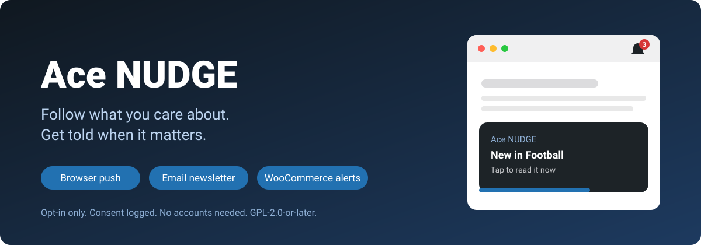
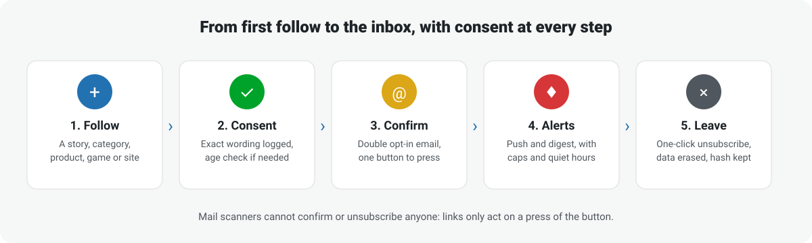
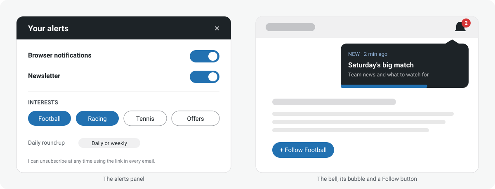
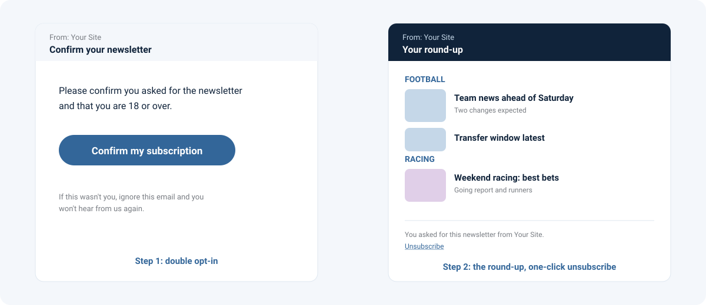
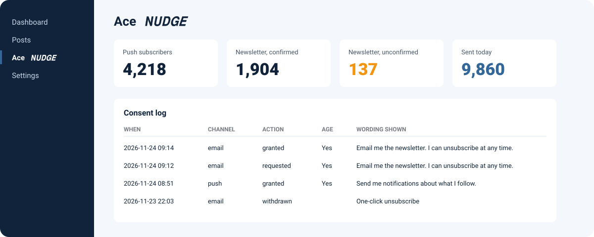

# Ace *NUDGE*

Notifications, Updates, Digests, Gated Email. Opt-in browser notifications and an email newsletter for WordPress, with consent evidence and an admin overview.

Visitors follow a story, product, category, scheduled live event or the whole site, with no account. Consent is logged with the exact wording shown. On WooCommerce sites, customers can also turn on order updates, back in stock and price drop alerts.

Current version: **0.7.4**. Requires WordPress 6.5 and PHP 8.1 with the OpenSSL extension.

## What it does

| Channel | How a person joins | What they get |
|---|---|---|
| Browser push | Follow button, bell or alerts panel, then the browser's permission prompt | Alerts for what they follow, within a daily cap and quiet hours |
| Email newsletter | Newsletter button or panel, then a double opt-in email | A daily or weekly round-up by category |
| WooCommerce | Checkout, account page or registration | Order updates on a device, and back in stock and price drop emails through WooCommerce's own mailer |
| In-page bell | Automatic, once something is followed | A list of new posts and real updates, worked out in the browser from a public cached feed |

The newsletter carries `List-Unsubscribe` and one-click `List-Unsubscribe-Post` headers. Confirm and unsubscribe links only act on a POST, so mail scanners cannot confirm or unsubscribe anyone.

Web Push is sent by the plugin itself (VAPID and `aes128gcm`), with no third-party service or library. Pages stay fully cacheable: the page carries only what is true for everyone, and the script decides the rest.

## What visitors see

## What you see

*Illustrations are stylised. Your site's colours, wording and categories will differ.*

## Modes

Set `ACE_NUDGE_MODE` in `wp-config.php`.

- `off` (default): nothing is printed or sent. Admin screens still work.
- `test`: the front end only shows after visiting `?ace_nudge_preview=1`. The newsletter only goes to addresses in `ACE_NUDGE_TEST_EMAILS`. Push only goes to subscriber ids in `ACE_NUDGE_TEST_PUSH`. `ACE_NUDGE_SHOW_ALL` shows the front end to everyone.
- `on`: open to visitors.

## Install

Download the zip from the [Releases page](https://github.com/AceMedia/Ace-Nudge/releases) and upload it under Plugins, Add New, Upload Plugin. Or check the repository out into `wp-content/plugins/ace-nudge`. Activate it, set the mode, then open **Ace NUDGE** in the admin menu.

The tables are created on the first request after activation. Site rules such as an age check, wording and branding come through filters, listed in [docs/hooks.md](docs/hooks.md).

## Documentation

- [Configuration](docs/configuration.md): constants, modes, every setting, admin screens, blocks
- [Architecture](docs/architecture.md): files, classes, cron and request flow
- [Data model](docs/data-model.md): the four tables, options and tokens
- [REST API](docs/rest-api.md): routes, parameters and responses
- [Hooks and the browser API](docs/hooks.md): filters, the action, constants, `window.aceNudge.api`
- [Push notifications](docs/push-notifications.md): requirements, VAPID keys, what is sent
- [Newsletter](docs/newsletter.md): sign-up, contents, unsubscribing
- [WooCommerce](docs/woocommerce.md): order updates, optional emails, product updates
- [Privacy and consent](docs/privacy.md): what is stored, erased and logged
- [Operations](docs/operations.md): WP-CLI, cron, limits, going live, deployment
- [Troubleshooting](docs/troubleshooting.md)
- [Developer guide](docs/developer-guide.md): extending through filters, with examples
- [Shared mailing list design](docs/shared-list-integration.md): a proposal for using *NUDGE* as the list for other plugins
- [Changelog](CHANGELOG.md)

The [GitHub wiki](https://github.com/AceMedia/Ace-Nudge/wiki) carries the same pages with an installation guide and FAQ.

## Blocks

Follow Button (`ace-nudge/follow`), Alerts Button (`ace-nudge/alerts-button`) and Newsletter Button (`ace-nudge/newsletter-button`). Each is server-rendered and lets a site place a control where it wants one.

## Known limits

Sending is one `wp_mail` call per subscriber inside a cron run, with no queue. There is no bounce or complaint handling and no manual campaign composer. Quiet hours and the newsletter schedule use the site's time zone. See [Operations](docs/operations.md) and [the shared list design](docs/shared-list-integration.md) for the plan.

## Building a release

`bin/build-zip.sh` writes `dist/ace-nudge-VERSION.zip` from the current commit. Pushing a tag such as `v0.7.1` builds the zip and publishes a release, with that version's section of the changelog as its notes.

## Contributing and security

See [CONTRIBUTING.md](CONTRIBUTING.md). Report security issues privately as described in [SECURITY.md](SECURITY.md), not in public issues.

## Licence

Copyright (C) 2026 Shane Rounce.

Ace *NUDGE* is free software, released under the [GNU General Public License, version 2 or (at your option) any later version](LICENSE). You may use, study, change and share it under those terms. It comes with no warranty. It bundles no third-party code.
